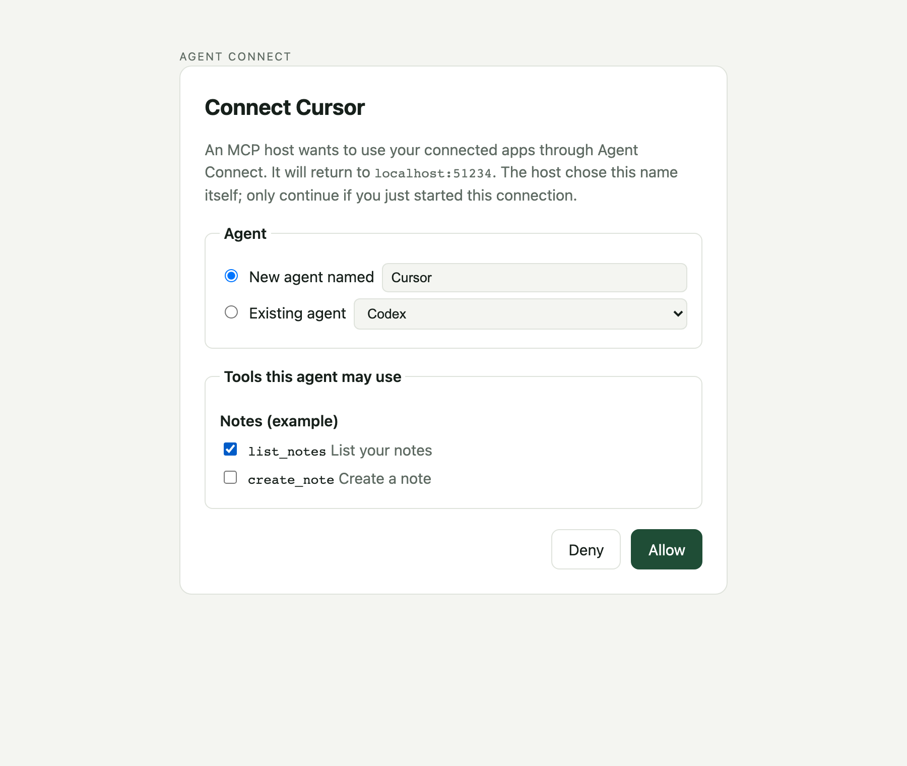
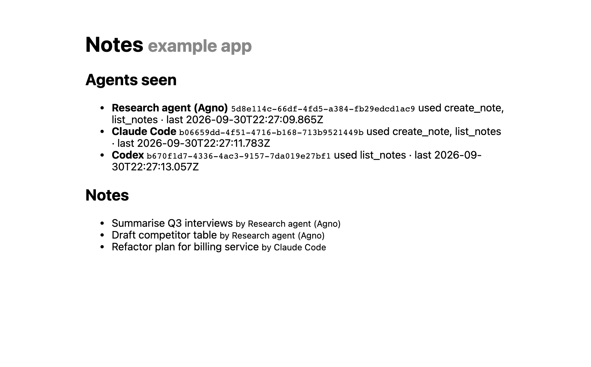
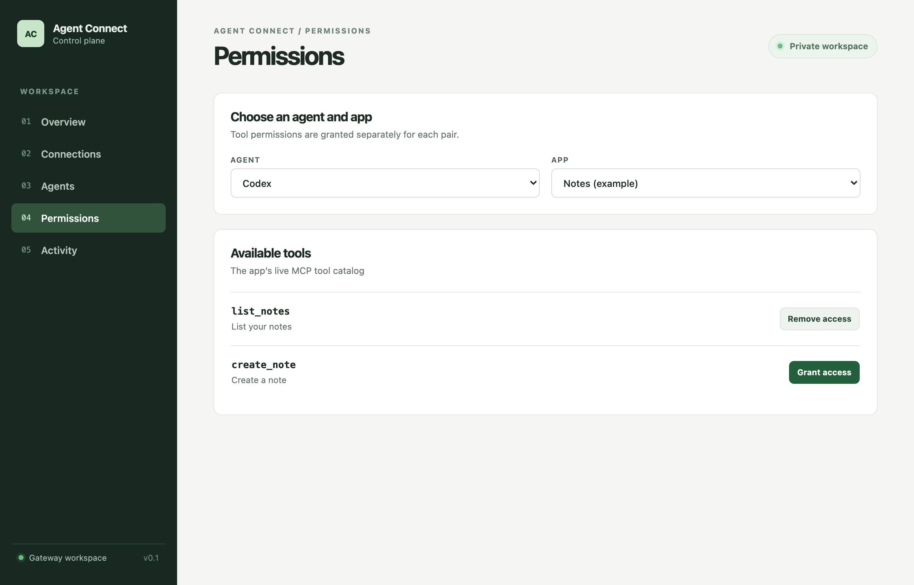

# Agent Connect

Agent Connect lets you give any AI agent access to your apps, with approval and per-tool permissions you control.

You connect an app once with its normal OAuth sign-in. Then any MCP host (Claude Code, Codex, Cursor, Agno, LangGraph, …) connects to Agent Connect with just a URL: the host opens a browser page where you name the agent and tick the tools it may use. No tokens to copy. The app sees a signed, verified identity for every agent that calls it, and you can revoke one agent without touching the others.


## How it works

```text
MCP host (Claude Code, Codex, Agno, …)
        │  MCP + OAuth token bound to one agent
        ▼
Agent Connect gateway  (Hono on Cloudflare Workers, Neon Postgres)
  ├─ host OAuth: metadata, client registration, consent, tokens
  ├─ per-agent tool grants, checked on every call
  ├─ encrypted app OAuth tokens, refreshed automatically
  └─ activity log
        │  app OAuth token + short-lived ES256 assertion naming the agent
        ▼
App MCP server ── @agent-connect/server-sdk verifies the agent
```

1. **Connect an app.** The app publishes `/.well-known/agent-connect.json` with the server SDK. You paste its URL into the control plane, sign in on the app's own OAuth page, and the gateway stores the app token encrypted.
2. **Connect a host.** Add the gateway's MCP URL to your host. The host follows the standard MCP authorization flow: protected resource metadata, dynamic client registration or a client ID metadata document, PKCE. You approve it on a consent page:

   

3. **Call tools.** The host only sees the tools you granted. On each call the gateway checks the grant, attaches the app token, and adds a signed assertion carrying the agent's ID and name, bound to that token and tool. The app verifies it with one SDK call and knows which agent acted:

   

Hosts without OAuth support can still use a static per-agent token from the Agents page.

| Agents | Permissions |
| --- | --- |
|  |  |

## Monorepo

| Path | Purpose |
| --- | --- |
| `apps/gateway` | Hono Cloudflare Worker: app OAuth, host OAuth, MCP router, grants, agent assertions, Neon storage |
| `apps/web` | React + Vite control plane for connections, agents, permissions and activity |
| `packages/server-sdk` | TypeScript SDK an app backend uses to publish discovery and verify agent calls |
| `examples/notes-app` | Example app with its own OAuth server and MCP server, using the server SDK |

The gateway serves two origins. The admin origin hosts the control plane and consent page behind Cloudflare Access. The MCP origin serves `/mcp`, the OAuth endpoints for hosts, and the JWKS apps use to verify assertions.

## Local development

Requires Node 22+ and Docker.

```bash
npm install
npm run setup:dev      # writes apps/gateway/.dev.vars with fresh local keys
npm run db:up          # Postgres + Neon HTTP proxy on 127.0.0.1:4444
npm run build:web && npm run build:sdk
npm run dev:gateway    # admin on http://localhost:8787, MCP on http://127.0.0.1:8787
npm run dev:notes      # example app on http://localhost:4000
node scripts/e2e.mjs   # full flow: app OAuth, grants, tool calls, host OAuth, revoke
node scripts/seed-demo.mjs   # optional: demo data for the control plane
```

Try it with a real host:

```bash
claude mcp add --transport http agent-connect http://127.0.0.1:8787/mcp
```

Local mode replaces Cloudflare Access with a fixed `DEV_OWNER`, allows `http://` app URLs on loopback hosts, and routes the Neon driver to the local proxy. Each only applies when `.dev.vars` sets it, and only on loopback addresses.

## Deploy

1. Create a [Neon](https://neon.tech) Postgres database and apply `apps/gateway/schema.sql`.
2. Set `PUBLIC_BASE_URL` (admin origin), `MCP_BASE_URL` (MCP origin), `ACCESS_ISSUER` and `ACCESS_AUD` in `apps/gateway/wrangler.jsonc`, and route both origins to the Worker.
3. Protect the admin origin with Cloudflare Access. Leave the MCP origin open; the Worker authenticates hosts there.
4. Set Worker secrets `DATABASE_URL` (Neon connection string), `ENCRYPTION_KEY` (32 random bytes, base64url) and `ASSERTION_PRIVATE_JWK` (P-256 private JWK with a unique `kid`). See `apps/gateway/.dev.vars.example`. Keep both keys stable.
5. For each app, register `PUBLIC_BASE_URL/oauth/callback` as a redirect URI, and configure the app's server SDK with `gatewayIssuer` set to `MCP_BASE_URL`.
6. `npm run deploy` builds the frontend and deploys the Worker.

Apps without a discovery document can be added through the manual setup form on the Connections page.

## Server SDK

```ts
import { createAgentConnectIntegration } from '@agent-connect/server-sdk'

const agentConnect = createAgentConnectIntegration({
  name: 'Notes',
  mcpUrl: 'https://notes.example.com/mcp',
  oauth: { authorizationUrl: '…/oauth/authorize', tokenUrl: '…/oauth/token', clientId: 'agent-connect', scope: 'notes' },
  gatewayIssuer: 'https://mcp.connect.example.com',
  verifyAccessToken: async token => /* your token check */ ({ userId: 'alice' }),
})

app.get('/.well-known/agent-connect.json', () => agentConnect.discoveryResponse())
// Inside an MCP tool handler:
const { appUserId, agentId, agentName } = await agentConnect.verifyToolCall(ctx.http.req, 'create_note')
```

See [packages/server-sdk/README.md](packages/server-sdk/README.md) and [examples/notes-app](examples/notes-app/src/server.ts).

## Current limits

- Only MCP tools are proxied. Resources, prompts, subscriptions and long-running tasks are not.
- Tested end to end with the MCP TypeScript SDK's OAuth client; not yet verified against each host (Claude Code, Codex, Cursor).
- Connecting the same app twice creates two connections.
- Concurrent requests can race when refreshing an app's token.
- Gateway tool names are `<connection id>__<tool>`, which is hard for models to read.
- The gateway lists each app's tools on every MCP request.
- Client registration has no rate limiting, and host names on the consent page are self-reported unless the host uses a client ID metadata document.
- Disconnecting an app deletes its tokens and grants but does not call the app's revocation endpoint.
- The discovery document and signed agent assertion are an Agent Connect contract, not an MCP standard.
