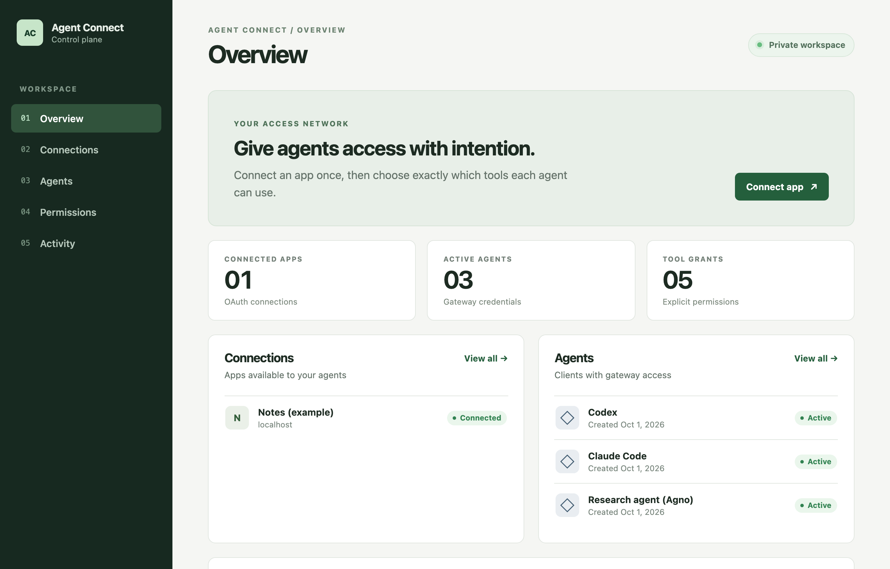
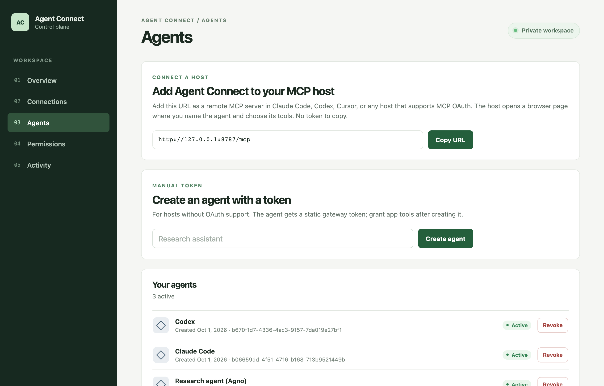

# Agent Connect

Agent Connect lets you give any AI agent access to your apps, with approval and per-tool permissions you control.

You connect an app once with its normal OAuth sign-in. Then any MCP host (Claude Code, Codex, Cursor, Agno, LangGraph, …) connects to Agent Connect with just a URL: the host opens a browser page where you name the agent and tick the tools it may use. No tokens to copy. The app sees a signed, verified identity for every agent that calls it, and you can revoke one agent without touching the others.



## How it works

```text
        YOU, in a browser                         AN AI AGENT
  control plane and consent page        inside an MCP host: Claude Code,
                                        Codex, Cursor, Agno, LangGraph, …
              │                                        │
              │ admin origin                           │ MCP origin
              │ (Cloudflare Access)                    │ (token of one agent)
              ▼                                        ▼
 ┌────────────────────────────────────────────────────────────────────────┐
 │  AGENT CONNECT   one Cloudflare Worker, code in apps/gateway           │
 │                                                                        │
 │  /api/*            connect apps,           /mcp   on every tool call:  │
 │                    create agents,                 1. find the agent    │
 │                    grant tools,                   2. check its grant   │
 │                    read activity                  3. call the app      │
 │  /oauth/authorize  consent page                   4. log the outcome   │
 │                                                                        │
 │  Neon Postgres                                                         │
 │    agents            who may call                                      │
 │    connections       which apps, with their encrypted credentials      │
 │    connection_tools  tools imported from OpenAPI specs                 │
 │    grants            agent + app + tool that is allowed                │
 │    action_log        every tool call and its outcome                   │
 └────────────────────────────────────────────────────────────────────────┘
              │                                        │
              │ app OAuth token                        │ API key or OAuth token
              │ + signed agent assertion               │ + signed agent assertion
              ▼                                        ▼
   APP WITH AN MCP SERVER                   APP WITH ONLY A REST API
   verifies the agent with                  described by an OpenAPI spec,
   @agent-connect/server-sdk                no code changes in the app
```

Read it top to bottom: you decide in the browser which agent may use which tool; the agent's host talks MCP to Agent Connect; Agent Connect calls the app with the app's own credential and tells the app which agent is acting.

1. **Connect an app.** The app publishes `/.well-known/agent-connect.json` with the server SDK. You paste its URL into the control plane, sign in on the app's own OAuth page, and the gateway stores the app token encrypted.
2. **Connect a host.** Add the gateway's MCP URL to your host. The host follows the standard MCP authorization flow: protected resource metadata, dynamic client registration or a client ID metadata document, PKCE. You approve it on a consent page:

   

3. **Call tools.** The host only sees the tools you granted. On each call the gateway checks the grant, attaches the app token, and adds a signed assertion carrying the agent's ID and name, bound to that token and tool. The app verifies it with one SDK call and knows which agent acted:

   

Hosts without OAuth support can still use a static per-agent token from the Agents page.

## Connect a legacy REST app

An app does not need an MCP server, OAuth, or the server SDK. If it has a REST API with an OpenAPI 3 spec, open **Connections → Import a REST API from an OpenAPI spec**, paste the spec URL, and enter an API key (or the app's OAuth endpoints). Nothing changes on the app's side.

The gateway imports the spec once and turns each operation into a tool: path and query parameters become arguments, and a JSON request body becomes the `body` argument. Agents get these tools through the same consent page and per-tool grants as any other app. On each call the gateway sends the stored credential and calls the REST API directly.

```text
MCP host ── MCP ──▶ Agent Connect gateway ── HTTPS + API key ──▶ legacy REST API
```

Every REST call also carries the signed `Agent-Connect-Assertion` header, so an app can start verifying which agent acted later without changing how it is connected. `POST /api/connections/:id/refresh` re-imports the spec after the API changes.

Limits of the adapter: OpenAPI 3.x only (JSON or YAML, up to 2 MB and 300 operations); JSON request bodies only, so upload and form operations are skipped; header and cookie parameters are ignored; API keys are sent in a header, not a query string; responses over 100 KB are refused; `$ref`s must point inside the same document.

| Agents | Permissions |
| --- | --- |
|  |  |

## Monorepo

| Path | Purpose |
| --- | --- |
| `apps/gateway` | Hono Cloudflare Worker: app OAuth, host OAuth, MCP router, OpenAPI adapter, grants, agent assertions, Neon storage |
| `apps/web` | React + Vite control plane for connections, agents, permissions and activity |
| `packages/server-sdk` | TypeScript SDK an app backend uses to publish discovery and verify agent calls |
| `examples/notes-app` | Example app with its own OAuth server and MCP server, using the server SDK |
| `examples/legacy-api` | Example REST API with an API key and an OpenAPI spec, and no MCP server, connected through the OpenAPI adapter |

The gateway serves two origins. The admin origin hosts the control plane and consent page behind Cloudflare Access. The MCP origin serves `/mcp`, the OAuth endpoints for hosts, and the JWKS apps use to verify assertions.

## Code layout

`apps/gateway/src` is organised by what the code does. A request enters through `routes/`, which calls plain functions in the other folders.

```text
apps/gateway/src
├─ index.ts       Worker entry point
├─ app.ts         mounts the routes and the middleware
├─ constants.ts   size limits, timeouts, token lifetimes
├─ types/         data shapes only, no logic
│    api.ts         the /api contract, imported by apps/web as well
│    agents.ts  connections.ts  tools.ts  hostAuth.ts  env.ts
├─ routes/        HTTP endpoints: read the request, call a function, answer
│    api/           /api/overview, /api/agents, /api/connections, /api/grants
│    mcp.ts         /mcp, the endpoint MCP hosts talk to
│    oauth.ts       /oauth/register, authorize, token (hosts) and callback (apps)
│    wellKnown.ts   OAuth metadata and the public keys for assertions
├─ middleware/    adminAuth: who is signed in to the control plane
├─ mcp/           the MCP server built for one agent, and its tool list
├─ hostAuth/      sign-in of MCP hosts: client checks, tokens, consent page HTML
├─ upstream/      everything that calls a connected app
│    appOAuth.ts    sign in to the app, store and refresh its tokens
│    mcpApp.ts      call an app that has an MCP server
│    openapiSpec.ts fetch an OpenAPI spec and convert operations to tools
│    restApp.ts     call an app that has only a REST API
│    assertion.ts   the signed JWT that names the agent
│    discovery.ts   read an app's /.well-known/agent-connect.json
├─ stores/        all SQL, one file per table or table group
└─ utils/         encryption and hashing, URL safety check, size-limited reads
```

What we are building is in [docs/SPEC.md](docs/SPEC.md). Decisions and what has been implemented are in [docs/LOG.md](docs/LOG.md).

## Local development

Requires Node 22+ and Docker.

```bash
npm install
npm run setup:dev      # writes apps/gateway/.dev.vars with fresh local keys
npm run db:up          # Postgres + Neon HTTP proxy on 127.0.0.1:4444
npm run build:web && npm run build:sdk
npm run dev:gateway    # admin on http://localhost:8787, MCP on http://127.0.0.1:8787
npm run dev:notes      # example app on http://localhost:4000
npm run dev:legacy     # example REST API on http://localhost:4100
node scripts/e2e.mjs   # full flow: app OAuth, grants, tool calls, host OAuth, revoke
node scripts/e2e-openapi.mjs   # OpenAPI adapter: import, grants, REST calls, revoke
node scripts/seed-demo.mjs   # optional: demo data for the control plane
```

Try it with a real host:

```bash
claude mcp add --transport http agent-connect http://127.0.0.1:8787/mcp
```

Local mode replaces Cloudflare Access with a fixed `DEV_OWNER`, allows `http://` app URLs on loopback hosts, and routes the Neon driver to the local proxy. Each only applies when `.dev.vars` sets it, and only on loopback addresses.

## Deploy

1. Create a [Neon](https://neon.tech) Postgres database and apply `apps/gateway/schema.sql`. For a database created before the OpenAPI adapter, apply `apps/gateway/migrations/001_openapi.sql` instead.
2. Set `PUBLIC_BASE_URL` (admin origin), `MCP_BASE_URL` (MCP origin), `ACCESS_ISSUER` and `ACCESS_AUD` in `apps/gateway/wrangler.jsonc`, and route both origins to the Worker.
3. Protect the admin origin with Cloudflare Access. Leave the MCP origin open; the Worker authenticates hosts there.
4. Set Worker secrets `DATABASE_URL` (Neon connection string), `ENCRYPTION_KEY` (32 random bytes, base64url) and `ASSERTION_PRIVATE_JWK` (P-256 private JWK with a unique `kid`). See `apps/gateway/.dev.vars.example`. Keep both keys stable.
5. For each app, register `PUBLIC_BASE_URL/oauth/callback` as a redirect URI, and configure the app's server SDK with `gatewayIssuer` set to `MCP_BASE_URL`.
6. `npm run deploy` builds the frontend and deploys the Worker.

Apps without a discovery document can be added through the manual setup form on the Connections page.

## Server SDK

```ts
import { createAgentConnectIntegration } from '@agent-connect/server-sdk'

const agentConnect = createAgentConnectIntegration({
  name: 'Notes',
  mcpUrl: 'https://notes.example.com/mcp',
  oauth: { authorizationUrl: '…/oauth/authorize', tokenUrl: '…/oauth/token', clientId: 'agent-connect', scope: 'notes' },
  gatewayIssuer: 'https://mcp.connect.example.com',
  verifyAccessToken: async token => /* your token check */ ({ userId: 'alice' }),
})

app.get('/.well-known/agent-connect.json', () => agentConnect.discoveryResponse())
// Inside an MCP tool handler:
const { appUserId, agentId, agentName } = await agentConnect.verifyToolCall(ctx.http.req, 'create_note')
```

See [packages/server-sdk/README.md](packages/server-sdk/README.md) and [examples/notes-app](examples/notes-app/src/server.ts).

## Current limits

- Only MCP tools are proxied. Resources, prompts, subscriptions and long-running tasks are not.
- Apps with neither an MCP server nor an OpenAPI spec (UI-only platforms) cannot be connected.
- The server SDK verifies agent assertions only inside MCP tool handlers, not yet in plain REST handlers.
- Tested end to end with the MCP TypeScript SDK's OAuth client; not yet verified against each host (Claude Code, Codex, Cursor).
- Connecting the same app twice creates two connections.
- Concurrent requests can race when refreshing an app's token.
- Gateway tool names are `<connection id>__<tool>`, which is hard for models to read.
- The gateway lists each app's tools on every MCP request.
- Client registration has no rate limiting, and host names on the consent page are self-reported unless the host uses a client ID metadata document.
- Disconnecting an app deletes its tokens and grants but does not call the app's revocation endpoint.
- The discovery document and signed agent assertion are an Agent Connect contract, not an MCP standard.
