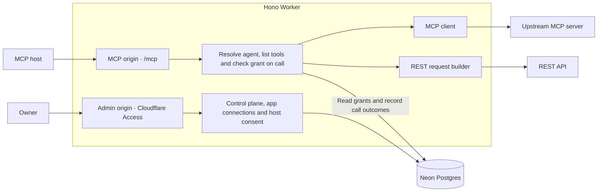

# Agent Connect gateway architecture

Agent Connect runs one Hono Worker backed by Neon Postgres. An owner connects an app once and grants individual tools to an agent. An MCP host can then use those tools whether the app exposes an MCP server or a REST API. The November 19 refactor moved routing, SQL and upstream calls into separate modules and gave the web app and gateway a shared API contract. [PR #1 at `eae566b`](https://github.com/Ayush0054/agent-connect/pull/1/commits/eae566b62135e88d50a4f556cec65e886065e660) · [Product requirements](SPEC.md) · [Decision and verification log](LOG.md)

## Current request paths

**Connect and grant.** The admin origin serves the React control plane, the host consent page and the callback for app OAuth. The MCP origin serves the host registration and token endpoints, OAuth metadata, assertion verification keys and `/mcp`. Host OAuth binds a host to an agent. App OAuth or an API key supplies the credential the gateway uses for a connected app. [Worker routes](../apps/gateway/src/app.ts) · [OAuth routes](../apps/gateway/src/routes/oauth.ts) · [Discovery and keys](../apps/gateway/src/routes/wellKnown.ts)

| Connection kind | Where tools come from | How the gateway calls the app |
| --- | --- | --- |
| MCP | The gateway discovers the app from its manifest or accepts manually entered endpoints. It lists tools live over MCP. | The MCP client forwards the tool name and arguments with the app's OAuth token. |
| OpenAPI | The gateway imports a JSON or YAML spec at connect or refresh time. Each supported operation becomes a `connection_tools` row with its name, method, path, input schema and argument locations. | The REST caller builds one HTTP request from the stored operation and attaches the app's OAuth token or API key. |

**Invoke and audit.** The MCP endpoint resolves a static agent token or host OAuth access token to an active agent. For each request, the server registers granted tools as `<connection id>__<tool>`. Immediately before invocation it rechecks the grant by agent, connection and tool name, including owner and revocation checks. Both callers attach a short-lived signed `Agent-Connect-Assertion` bound to the app credential and tool. The gateway records forwarded call outcomes in `action_log`. A legacy API can ignore the assertion and still be attributed in the gateway log. [MCP server](../apps/gateway/src/mcp/server.ts) · [Grant checks](../apps/gateway/src/stores/grants.ts) · [Assertion](../apps/gateway/src/upstream/assertion.ts)

## Where changes belong

| Change | Owning code |
| --- | --- |
| Routes and authentication | `index.ts` exports the Worker. `app.ts` mounts routes and admin middleware. `routes/` handles HTTP, and `hostAuth/` owns host authorization helpers and consent HTML. [App](../apps/gateway/src/app.ts) · [Host consent](../apps/gateway/src/hostAuth/pages.ts) |
| Control-plane API | `types/api.ts` defines request and response shapes. Gateway handlers use `satisfies` for typed responses, and the React client imports the shared types. [Contract](../apps/gateway/src/types/api.ts) · [Web client](../apps/web/src/api.ts) |
| Persistence | SQL lives in table-specific functions under `stores/`. Connection rows hold encrypted credentials. `mcp_url` stores either the app's MCP endpoint or its REST base. [Stores](../apps/gateway/src/stores/) · [Schema](../apps/gateway/schema.sql) |
| Tool listing and dispatch | `mcp/tools.ts` selects the catalog for consent and the admin API. `mcp/server.ts` registers and invokes granted tools. Both use plain functions and branch on the two connection kinds. [Tool listing](../apps/gateway/src/mcp/tools.ts) · [Dispatch](../apps/gateway/src/mcp/server.ts) |
| Upstream protocols | `upstream/` owns discovery, app OAuth, signing, spec import and app calls. Limits and token lifetimes live in `constants.ts`. [OpenAPI importer](../apps/gateway/src/upstream/openapiSpec.ts) · [REST caller](../apps/gateway/src/upstream/restApp.ts) · [MCP client](../apps/gateway/src/upstream/mcpApp.ts) · [Limits](../apps/gateway/src/constants.ts) |

## Proposed changes to REST grants and refresh

Today a grant is keyed by `(agent_id, connection_id, tool_name)`. Refresh keeps the stored base URL, deletes the old tool rows, inserts replacements one at a time, then removes grants for missing names. Two consequences drive the next change. A failed insert can leave a partial catalog, and a spec can reuse a granted name for a different HTTP operation. [Refresh route](../apps/gateway/src/routes/api/connections.ts) · [Catalog writes](../apps/gateway/src/stores/connectionTools.ts) · [PR review](https://github.com/Ayush0054/agent-connect/pull/1#pullrequestreview-5964822182)

1. **Publish the catalog atomically.** Compile the candidate before opening a transaction. At connect time, commit the connection and its operations together. At refresh, check the starting revision, bulk-write the operations, reconcile grants and advance the revision in one transaction. A failed write leaves the previous catalog usable. A concurrent revision change requires a fresh comparison.
2. **Give each approved operation a stable identity.** Match REST operations by connection, approved server base, HTTP method and path template. Preserve the public MCP name as an alias. On migration, backfill grants only where the previously approved operation can be established. Ask for renewed consent for ambiguous REST grants and keep existing native MCP grants readable.
3. **Bind consent and dispatch to that identity.** Have the admin UI and host consent page submit the operation ID and displayed catalog revision. If the revision is stale, show the changed selection before saving. When an agent calls a tool, look up the grant and its current operation together, dispatch that definition, and record the operation ID and revision in the activity log.

| Change on refresh | Proposed grant behavior |
| --- | --- |
| Description or display name changes, request remains equivalent | Preserve the operation ID and its grants. Keep the public alias stable where possible. |
| Server base, method or path changes, or argument mapping changes what the operation can do | Retire the old binding and require approval for the replacement. Confirm a new server base before using its credential. |
| Operation disappears | Revoke its grants in the same transaction. A later reintroduction starts without grants. |

## Proposed changes to OpenAPI onboarding

On first import, the gateway uses the entered base URL or derives one from the spec's first root server. The API-key form collects the credential before the owner sees the resolved destination. Preview the effective base and skipped operations before accepting a credential. Resolve path- and operation-level server overrides during import, and explain any operation that falls outside the approved base. [Connection route](../apps/gateway/src/routes/api/connections.ts) · [OpenAPI server precedence](https://spec.openapis.org/oas/v3.0.4.html#operation-object)

Persist supported parameter encodings alongside the argument locations. Today every query array becomes repeated keys, even when an operation expects one comma-separated value. Generate the input schema and outbound request from the same definition, and report unsupported operations at import. Reset the form after a successful import so a failed attempt leaves the owner's entries available for correction. [REST caller](../apps/gateway/src/upstream/restApp.ts) · [Import form](../apps/web/src/pages.tsx) · [OpenAPI serialization examples](https://spec.openapis.org/oas/v3.0.4.html#style-examples)

## Verification record

The November 19 log records passing gateway and web type checks, a web build, 30 OpenAPI end-to-end checks and 31 MCP end-to-end checks after the refactor. Those runs used local Postgres 14 and a stand-in for the Neon HTTP proxy. The Docker Compose stack was last exercised before the refactor. OAuth-backed REST calls and a deployed Worker remain open verification cases. [Verification log](LOG.md)

For the proposed changes, prioritize a renamed tool with an equivalent request, a reused name with a changed target, a failed or concurrent refresh and approval submitted from a stale catalog. These cases exercise the boundary between what the owner saw and what the agent can invoke.
